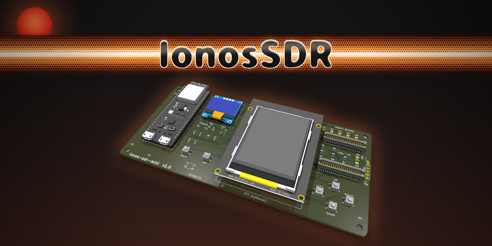

<h3 align="center">An open, calibrated, low-cost SDR built from a stock Silicon Labs sub-GHz SoC</h3>

EFR32FG23 radio · 16-bit I/Q · USB, WiFi and Raspberry Pi hosts · SDR++ / SpyServer · open hardware and firmware

---

**Ionos SDR** turns the Silicon Labs EFR32FG23 sub-GHz SoC, a part that ships in millions of IoT products, into a receiver and transmitter that you can use and understand. The radio streams raw I/Q to a host. Everything that is claimed is measured, and the measurements are published with the raw data.

Who it is for:

- **Radio amateurs:** 2 m APRS, WSPR, FM and CW, with a waterfall on the device.
- **Students and educators:** a real radio whose whole signal chain is open, from the RF front end to the decoder.
- **IoT engineers:** sniffing, site surveys and regression tests on the exact PHY that your product uses.
- **Researchers and space projects:** a remotely accessible SDR, aimed at LEO satellite reception.

## Repositories

<table>
<tr>
<td width="33%" valign="top">

<h3><a href="https://github.com/ionos-sdr/ionos-sdr">ionos-sdr</a></h3>
The main project: FG23 and ESP32-S3 firmware, <code>libionos</code>, the SpyServer streaming server and the measured facts.
</td>
<td width="33%" valign="top">

<h3><a href="https://github.com/ionos-sdr/ionos-sdr-mini">ionos-sdr-mini</a></h3>
A carrier PCB that turns a stock Silicon Labs radio board and an ESP32-S3 DevKit into a usable SDR. No custom RF design is needed.
</td>
<td width="33%" valign="top">

<h3><a href="https://github.com/ionos-sdr/ionos-maximus-rpi-sdr">ionos-maximus-rpi-sdr</a></h3>
Raspberry Pi host variant. I/Q goes over SPI straight into Linux, targeting about 1 Msps. Currently in the measurement phase.
</td>
</tr>
</table>

## What already works (measured)

| | |
|---|---|
| I/Q capture on the FG23 | 1 Msps at 270 kHz filter bandwidth, zero-copy, about 11 % CPU |
| Host streaming | about 250 ksps int16 over USB, about 175 ksps over WiFi |
| SDR++ | live I/Q over a SpyServer-compatible server |
| APRS | AX.25 frames with NCO-AFSK, decoded on-air and seen on aprs.fi |
| FM | NBFM voice and music transmit, received on a handheld radio |
| WSPR | encoder bit-exact against a reference implementation; on-air TX with a VCTCXO in progress |
| On-device display | FFT waterfall on a 2.8" TFT |

The details, raw data and methods are in each repository.

## Open by design

| | |
|---|---|
| Firmware and host code | MIT |
| SDR++ module | GPL-3.0 |
| Hardware | CERN-OHL-P-2.0, designed for clone-friendly manufacture |
| Documentation and measurements | CC-BY-4.0 |

## Get involved

- Star and watch the repositories to follow progress.
- Open an issue with your use case, your measurement results or the radio board you have.
- For engineering, measurement or integration work on Silicon Labs radios, contact [Z2 Labs](https://z2labs.io).

Made by Zoltán Dóczi (HA7DCD) and Zoltán Papp, Z2 Labs, Budapest. Brand assets and the card generator are in <a href="https://github.com/ionos-sdr/.github/tree/main/brand">brand/</a>.
